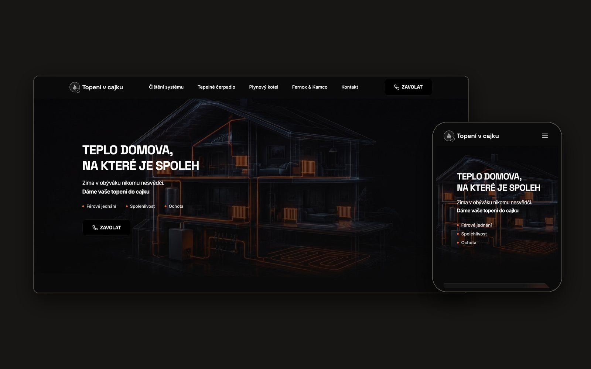

# topenivcajku.com

Website for **Topení v cajku**, a heating engineer in Brno and the South Moravian region, Czech Republic.
Client project: from UX discovery to a live, responsive website.

**Live:** [topenivcajku.com](https://topenivcajku.com)



## The brief

A small trade business needs a website that does one job well: help a homeowner with a heating problem understand the offer, trust the company and call.

- **A clear offer:** cleaning of heating systems, heat pumps, gas boiler service and installation, written in plain language without technical jargon.
- **Trust signals** placed where a visitor hesitates.
- **One action:** call, with a *Zavolat* (Call) button in the header and in the hero.

## My role

UX discovery, responsive design in Figma, copywriting (Czech), build and deployment.

## Tech

React, TypeScript, Vite and Tailwind CSS, with Radix UI components.
The design started in Figma; the first code bundle came from Figma Make and was then refined with AI assistance (Claude Code).

```
src/app/       App.tsx and page components
src/styles/    theme and global styles
public/        images and static files
```

Run locally:

```bash
npm install
npm run dev     # development server
npm run build   # production build in dist/
```

Third-party licences are listed in [ATTRIBUTIONS.md](ATTRIBUTIONS.md).

---

Designed and built by [Inna Macháč Guba](https://innaguba.com).
